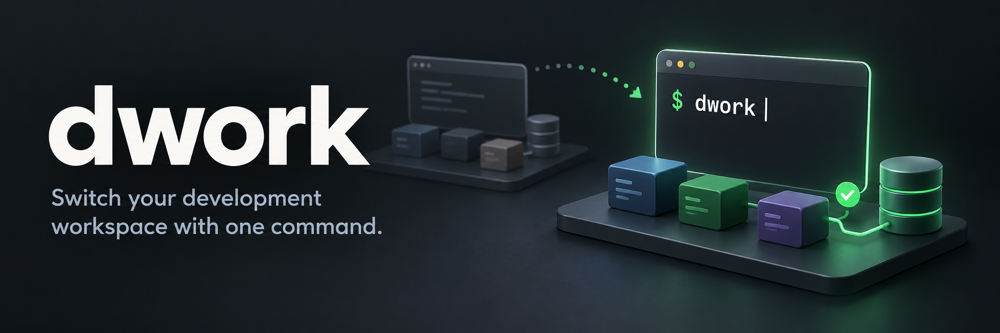

<div align="center">



<p><strong>Your project. Its containers. Your terminals. One command.</strong></p>

<p>
  <a href="docs/installation/README.md"></a>
  <a href="#install"></a>
  <a href="https://github.com/hayyaun/dwork/stargazers"></a>
</p>

<a href="#get-started">Get started</a> ·
<a href="examples/README.md">Examples</a> ·
<a href="docs/README.md">Documentation</a>

</div>

`dwork` switches your development workspace. It resumes a project's existing
containers, waits for healthy dependencies, and opens your commands and browser URLs.
Switches stop eligible registered workspaces; locked workspaces and unregistered
projects stay running. Use `dwork scan` to find and remember existing projects;
see [getting started](#get-started).

## Install

```sh
sh -c "$(curl -fsSL https://raw.githubusercontent.com/hayyaun/dwork/main/install.sh)"
```

Installs the latest `main` source for your user with isolated Python dependencies.
No `sudo` or shell sourcing required. If `~/.local/bin` is missing from `PATH`,
the installer prints the line to add it.

Requires Git, Make, curl, and Python with `venv`: **3.10+ on Linux/WSL2** or
**3.13+ on macOS**. Container workspaces also need Docker and Docker Compose;
terminal tasks need a [supported terminal](docs/terminals/README.md).

[Inspect the installer](install.sh) ·
[Installation, updates, and removal](docs/installation/README.md) ·
[v0.6.0 release packages](https://github.com/hayyaun/dwork/releases/tag/v0.6.0) ·
[Releases and package checks](docs/publishing/README.md)

### Optional tray companion

Switch saved workspaces from your desktop tray. On **native Linux or macOS**,
include the separate tray package during installation:

```sh
TRAY=1 sh -c "$(curl -fsSL https://raw.githubusercontent.com/hayyaun/dwork/main/install.sh)"
```

[Prerequisites and manual launch](docs/installation/README.md#optional-native-tray).
Installation does not launch the tray or enable login startup. Native Linux/macOS
users can optionally run `dwork-tray --autostart enable` for their next graphical
login. [Startup options](docs/companion/README.md#startup-at-login-is-opt-in).

On **Windows/WSL2**, use the [portable ZIP](https://github.com/hayyaun/dwork/releases/download/v0.6.0/dwork-tray-0.2.2-windows-x64.zip);
no separate Windows Python is needed.
[Windows setup](docs/companion/README.md#set-up-the-portable-app) ·
[Optional sign-in startup](docs/companion/README.md#windowswsl-start-at-sign-in-with-a-shortcut).

## Get started

Find your projects, then switch to one:

```sh
cd ~/projects
dwork scan           # Find and remember workspaces
dwork list           # Show their names
dwork switch my-app  # Use a name from the list
```

Scanning saves projects without starting or stopping anything. Switching shows
the plan and asks for confirmation.

For a new config, use [agent setup](#let-your-coding-agent-set-it-up) or run `dwork init` inside your
project. Existing Compose projects work without a `dwork.yml`.

> dwork starts existing containers. It never creates, rebuilds, or removes them.
> Complete your project's initial setup and migrations first.

[All commands](docs/usage/README.md) ·
[Scanning, groups, and locks](docs/workspaces/README.md)

## Describe your workspace

For a backend with a database, put this `dwork.yml` beside your Compose file:

```yaml
# yaml-language-server: $schema=https://raw.githubusercontent.com/hayyaun/dwork/main/schemas/dwork.schema.json
version: 1
compose:
  enabled: true
  services: [postgres]

terminals:
  - title: Backend
    command: [make, run]
    wait_for:
      healthy: [postgres]
      timeout: 180

browsers:
  - url: http://localhost:3000
    wait_for:
      timeout: 60
```

**Start the database → wait for healthy → open the backend → open its URL when ready.**
Missing containers or failed health checks block dependent tasks.

[Copy a full-stack, Compose-only, or host-only example](examples/README.md) ·
[Configuration reference](docs/configuration/README.md)

## Let your coding agent set it up

Install the optional agent skill with Node.js 22.20+:

```sh
npx skills add hayyaun/dwork --skill dwork -g
```

Then ask your agent: **"Use the dwork skill to create dwork.yml for this project."**
The skill inspects your existing commands and Compose services.
[Agent setup and usage](docs/skills/README.md)

## Explore more

- [Bash and Zsh completion, including macOS Bash 3.2](docs/completion/README.md)
- [Terminal options and background tasks](docs/terminals/README.md)
- [Browser selection and readiness checks](docs/browsers/README.md)
- [Optional tray companion](docs/companion/README.md), including a portable Windows app for WSL and a [replaceable icon](docs/companion/README.md#tray-icon)
- [Development, tests, and package build prerequisites](docs/development/README.md)
- [All documentation](docs/README.md)
